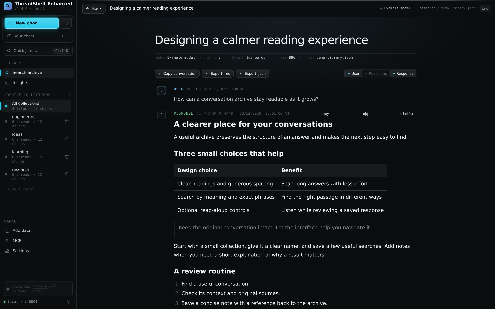
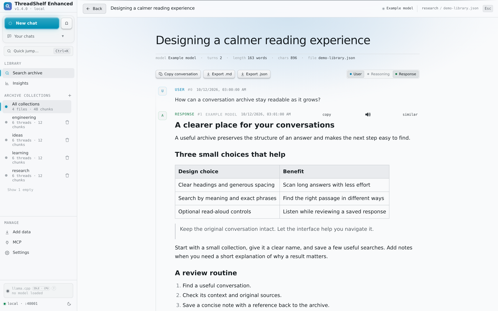
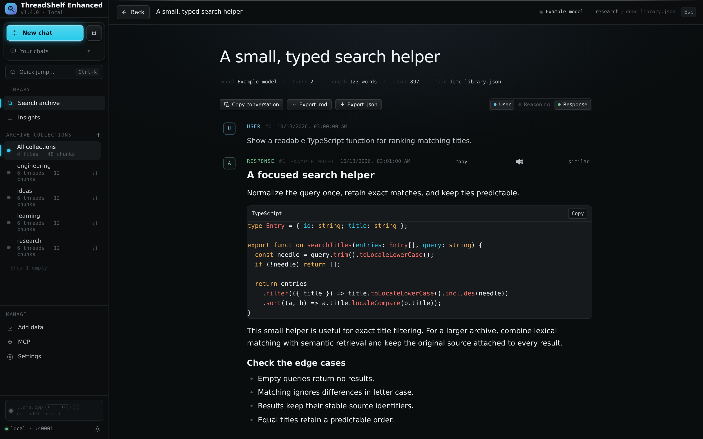
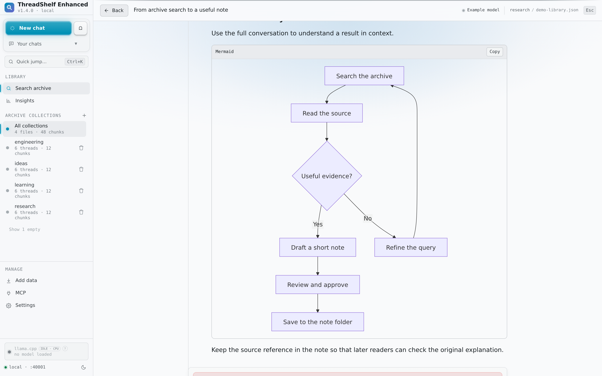
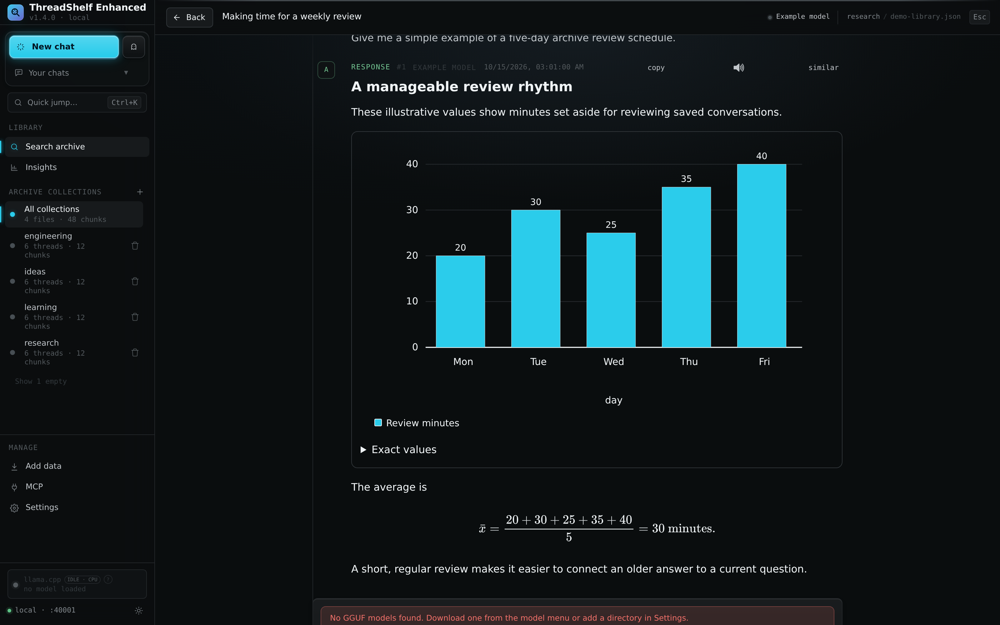
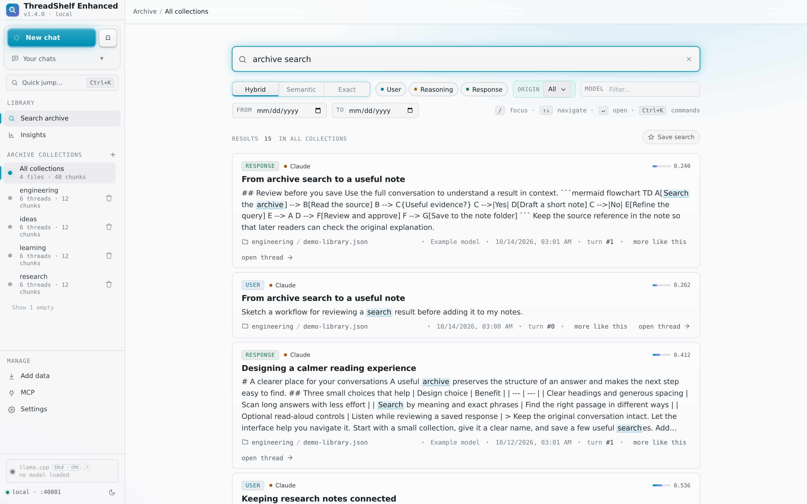
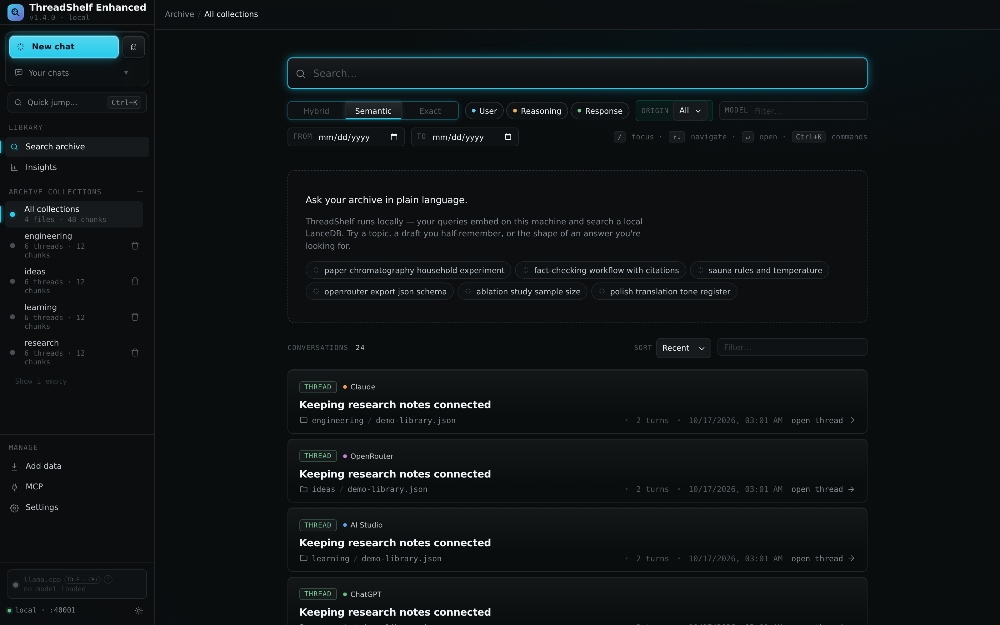
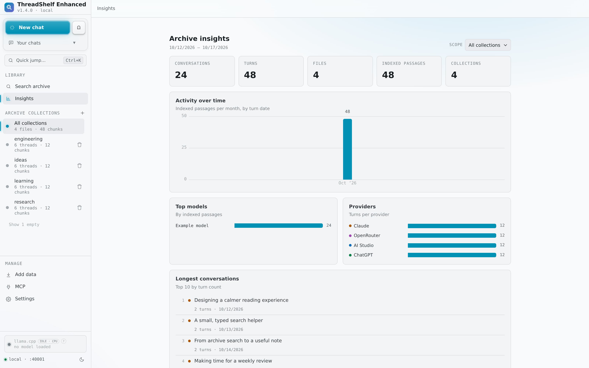
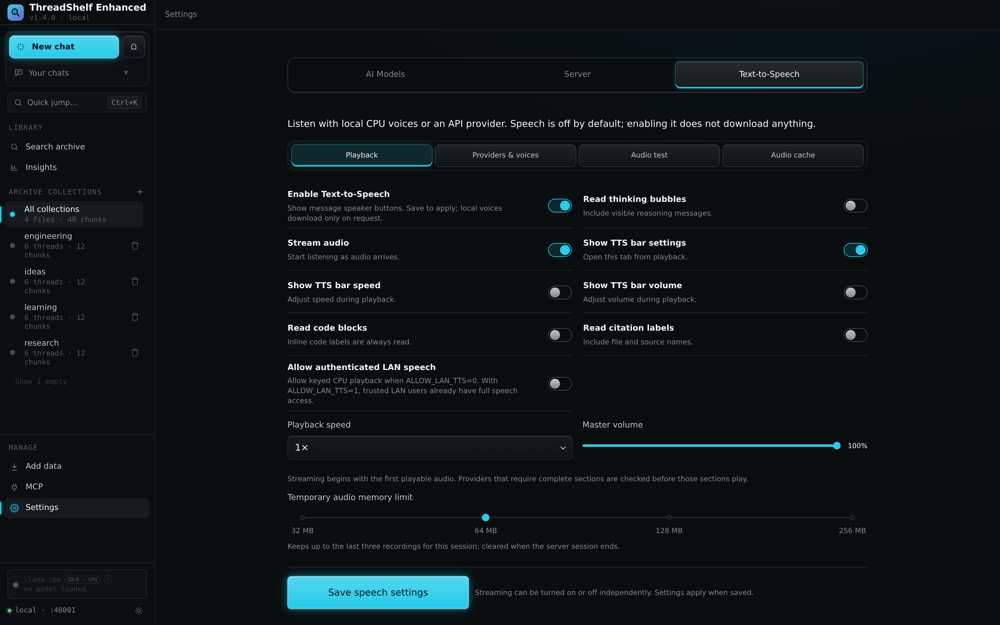
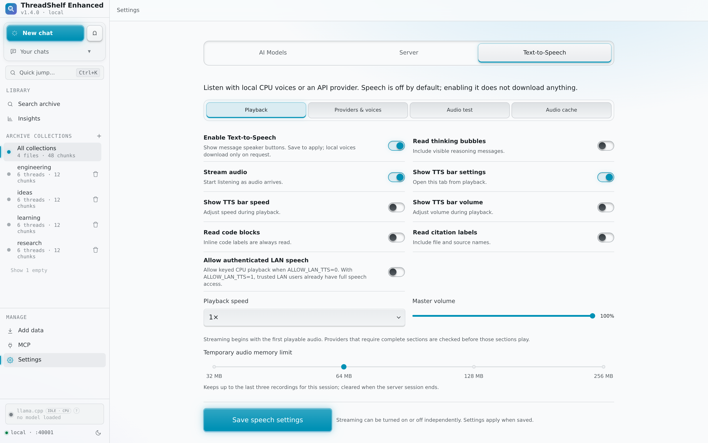

# Interface gallery

[Back to the project README](../../README.md)

Ten screenshots of the running ThreadShelf Enhanced 1.4.0 web interface,
captured with a fresh temporary archive. All conversations, dates, model labels
and chart values are synthetic demonstration content. The archive contains 24
conversations across four collections. No existing user profile or archive is used.

Each PNG is 3200 pixels wide, captured at twice the browser's layout resolution.
Regenerate the images with `npm run build:client` and `npm run docs:screenshots`.
The capture script uses real storage, search and UI routes. Speech is enabled only
in its temporary profile; no model is installed and no audio is synthesized.

## 1. Conversation reader — dark theme

Headings, emphasis, a comparison table and a quotation preserve the structure of an archived answer.

## 2. Conversation reader — light theme

The same conversation and framing in the light palette.

## 3. Highlighted code — dark theme

A TypeScript example with syntax highlighting, a language label and a copy control.

## 4. Mermaid diagram — light theme

A branching workflow diagram rendered alongside the surrounding conversation.

## 5. Chart and mathematics — dark theme

An illustrative reading schedule rendered as a bar chart, followed by its typeset average calculation.

## 6. Hybrid search — light theme

Search across collections with combined lexical and semantic retrieval, complete filters and highlighted matches.

## 7. Archive browsing — dark theme

A populated archive list with provider and collection details.

## 8. Archive Insights — light theme

Conversation totals, activity over time, model and provider distributions, and the longest conversations in the demo archive.

## 9–10. Text-to-speech settings — both themes

Enable speech, review optional local voice installation and configure playback.
The illustrated profile has no downloaded voices; CPU testing stays unavailable.

## Manual importer demonstration

[Watch the MP4](manual-importer-demo.mp4) or [download the asciicast](manual-importer-demo.cast).

This recorded workflow uses simulated import results, synthetic exports and
generic paths. It illustrates the interactive, combined and flags-only flows;
current defaults and labels may differ from the recording.

## Linux setup demonstration

Install ThreadShelf Enhanced on Linux, from checking prerequisites and running setup through verifying, starting, stopping, and restarting the server.

[Watch on asciinema](https://asciinema.org/a/1270050) · [Watch the MP4](ThreadShelf-Enhanced-How-to-Set-Up-Linux.mp4) · [Download the asciicast](ThreadShelf-Enhanced-How-to-Set-Up-Linux.cast)
