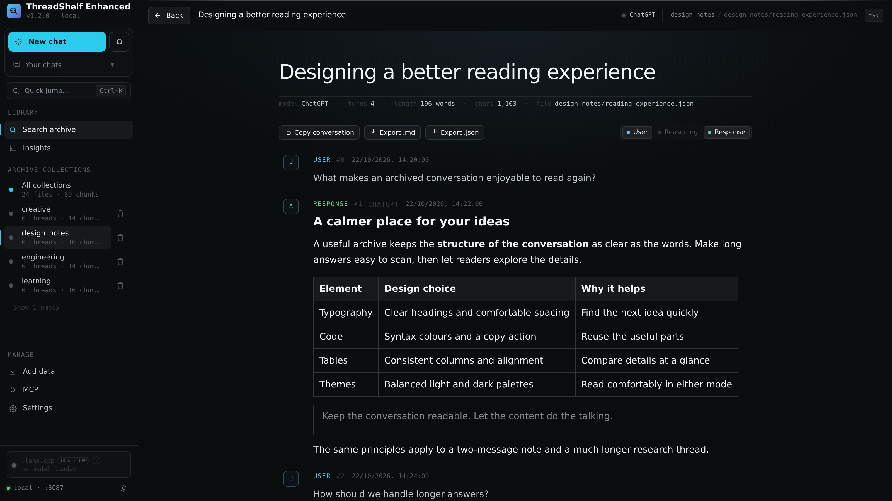
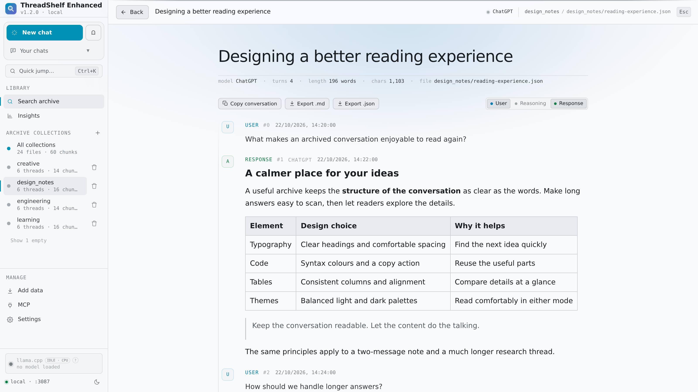
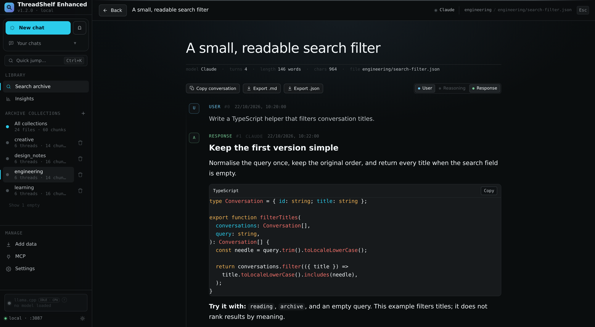
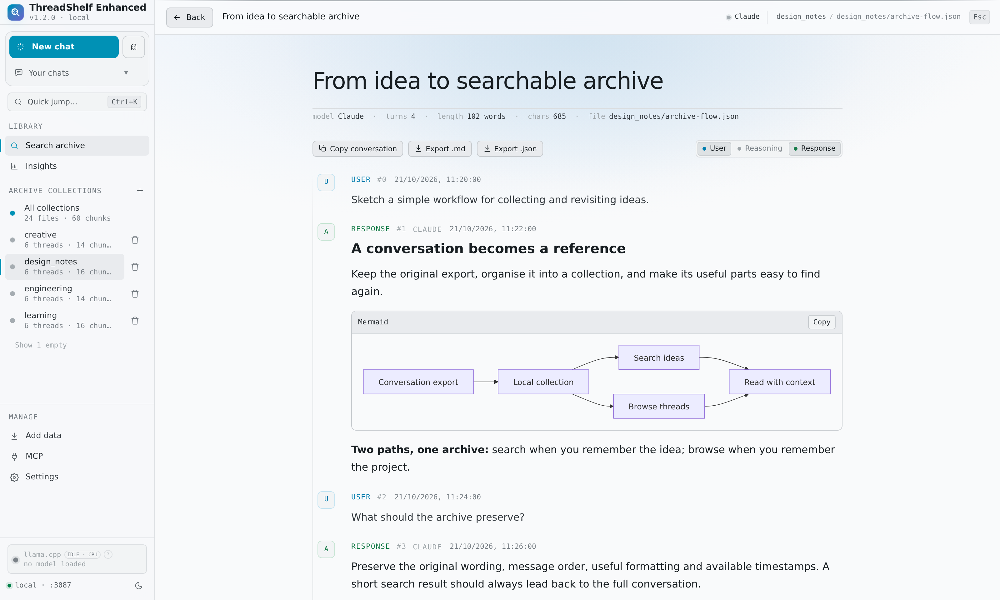
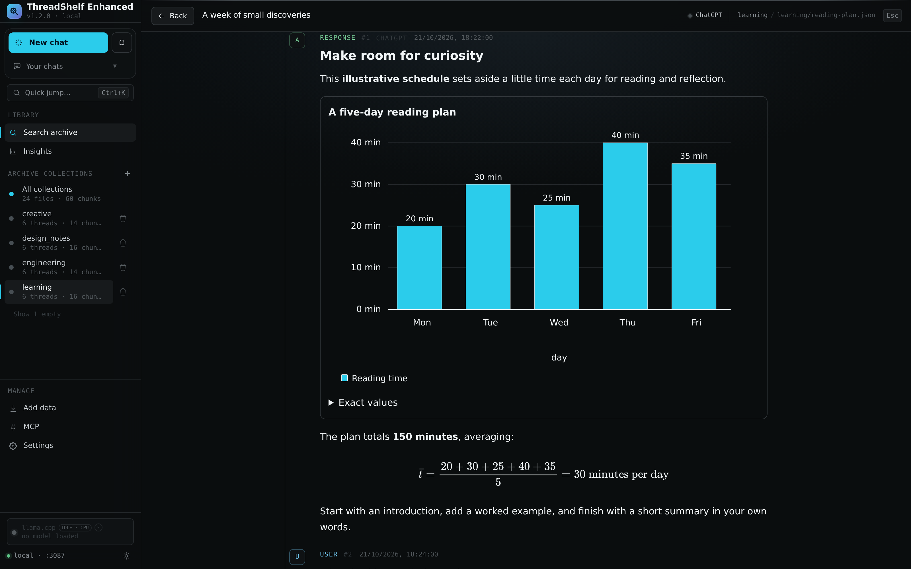
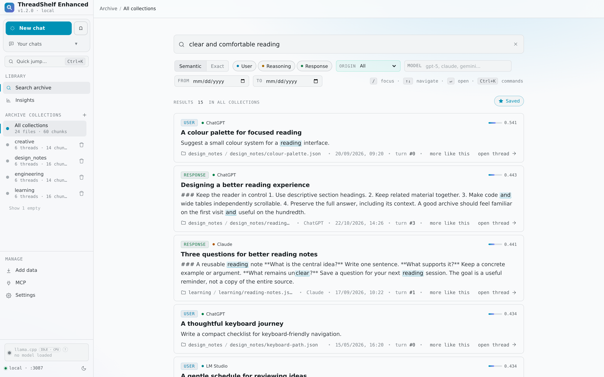
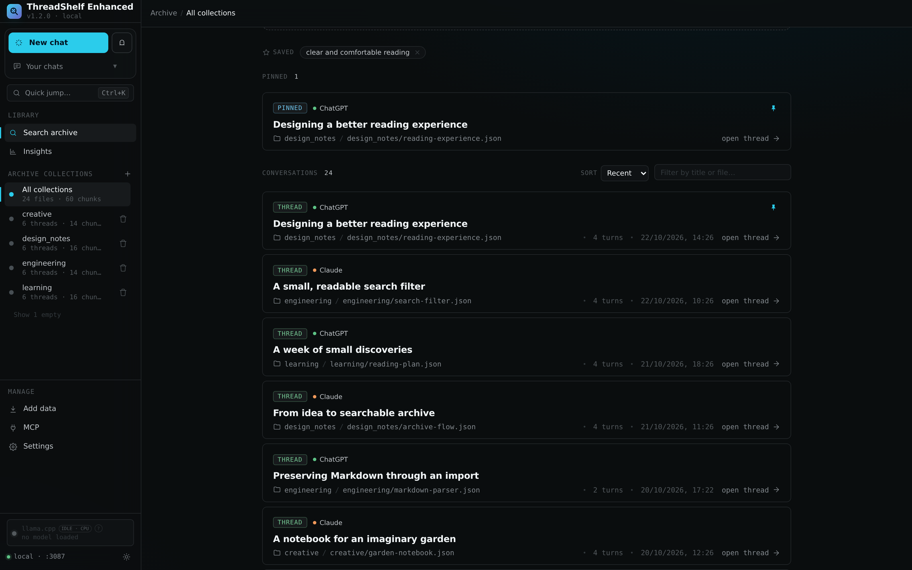
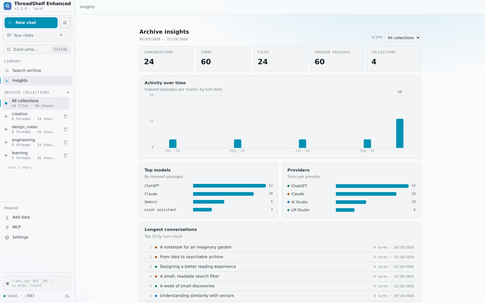

# Interface gallery

[Back to the project README](../../README.md)

Eight screenshots of the running ThreadShelf Enhanced 1.2.0 web interface, captured with a fresh demo archive. All conversations, dates, provider/model labels and chart values are synthetic demonstration content. The archive contains 24 conversations across four collections.

Each PNG is 3200 pixels wide, captured at twice the browser's layout resolution for clear text. Open an image to inspect it at full resolution.

## 1. Conversation reader — dark theme

Headings, emphasis, a comparison table and a quotation preserve the structure of an archived answer.

## 2. Conversation reader — light theme

The same conversation and framing in the light palette.

## 3. Highlighted code — dark theme

A TypeScript example with syntax highlighting, a language label and a copy control.

## 4. Mermaid diagram — light theme

A branching workflow diagram rendered alongside the surrounding conversation.

## 5. Chart and mathematics — dark theme

An illustrative reading schedule rendered as a bar chart, followed by its typeset average calculation.

## 6. Semantic search — light theme

Search across collections, inspect ranked passages and highlighted matches, and save a useful query.

## 7. Archive browsing — dark theme

A saved search, a pinned conversation and a populated archive list with provider and collection details.

## 8. Archive Insights — light theme

Conversation totals, activity over time, model and provider distributions, and the longest conversations in the demo archive.

